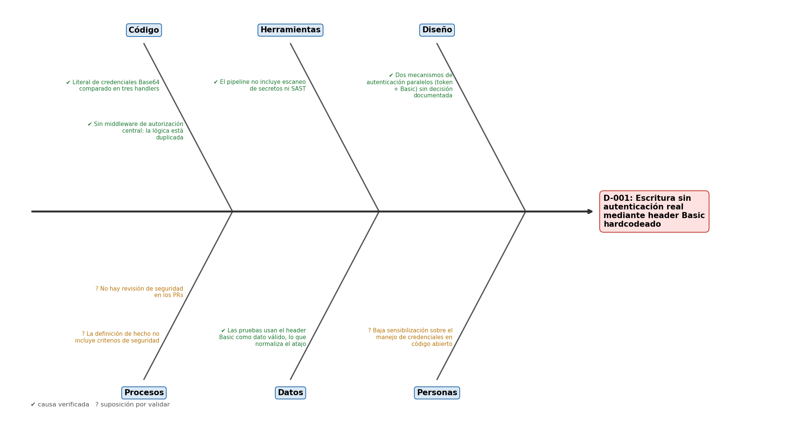
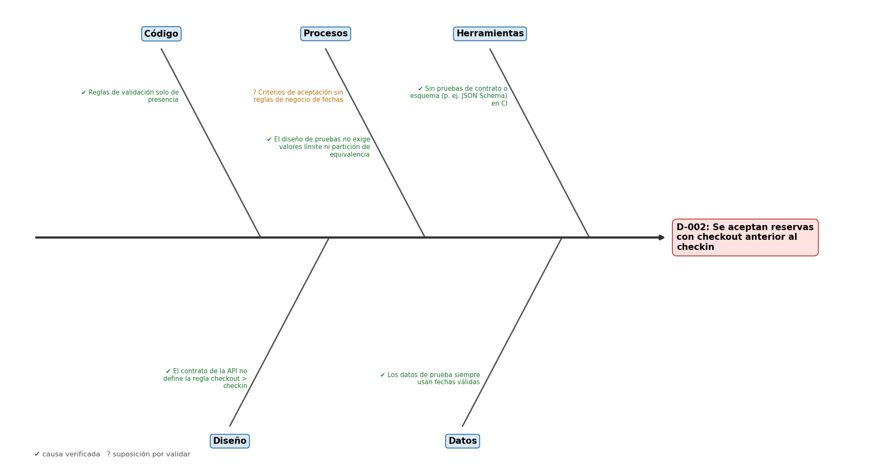
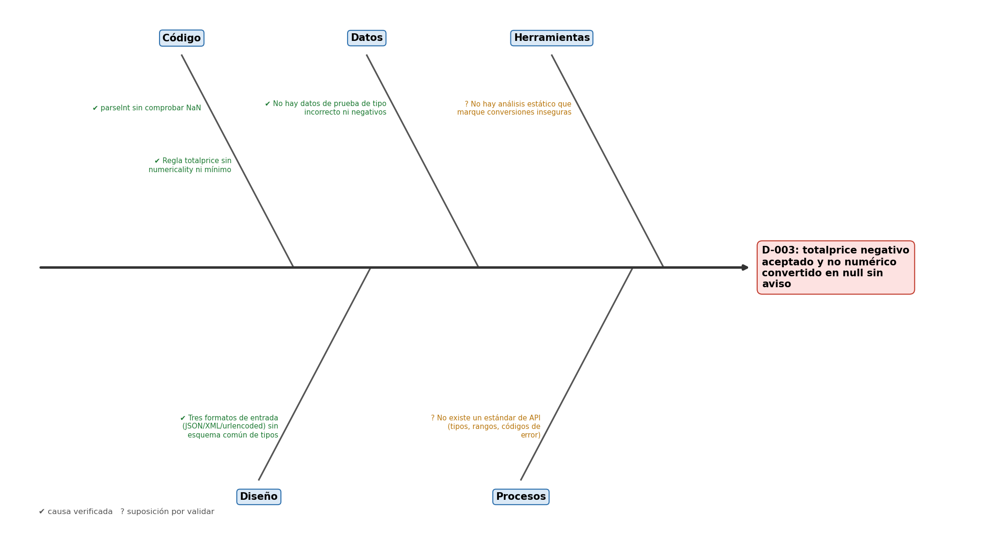
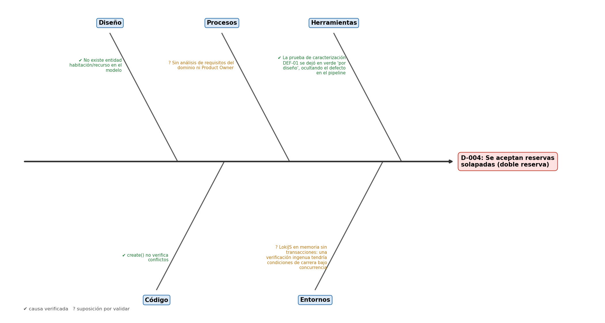
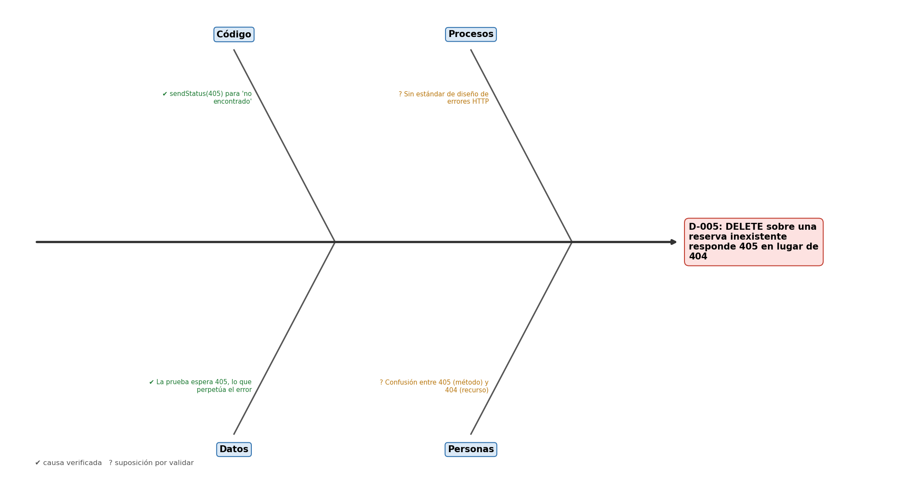
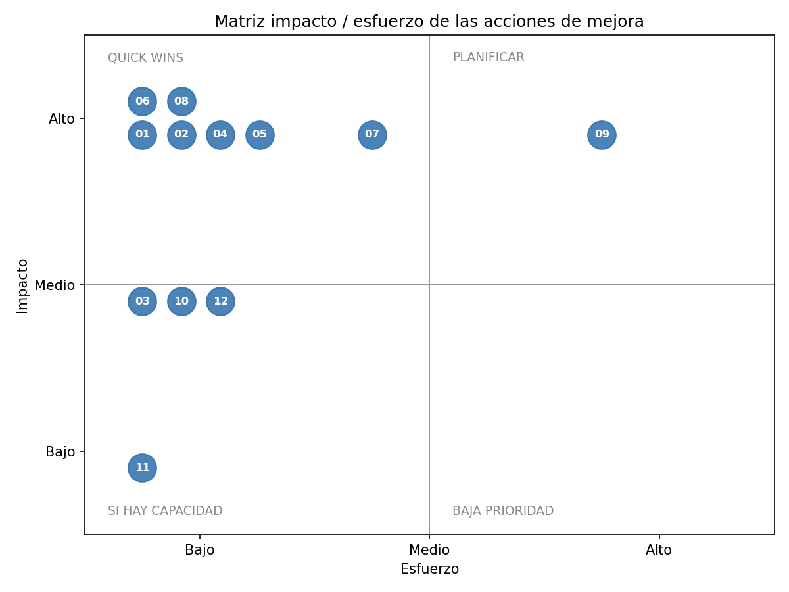

# Los defectos que llevamos al triage

No inventamos defectos para esta actividad. Usamos los que encontramos al ejecutar el Master Test Plan de la Actividad 2, cada uno con su evidencia curl. Les pusimos un código nuevo (D-001 a D-005) que se repite en el acta, en el análisis, en el plan y en el nombre de las pruebas del pipeline, para poder seguir cada defecto de principio a fin. Las referencias `archivo:línea` son del código original (commit `02c4ced`).

| Código | Origen | Qué pasa | Evidencia |
|------|------------|------------------------------------|------------------------|
| D-001 | DEF-04 / Riesgo R3 | Escritura sin autenticación real mediante header Basic hardcodeado | `triage/evidencia/T03_auth_hardcoded.txt` |
| D-002 | Riesgo R1 / caso T01 | Se aceptan reservas con checkout anterior al checkin | `triage/evidencia/T01_checkout_antes_checkin.txt` |
| D-003 | DEF-03 / Riesgo R4 | totalprice negativo aceptado y no numérico convertido en null sin aviso | `triage/evidencia/T04_totalprice_negative.txt` |
| D-004 | DEF-01 / Riesgo R2 | Se aceptan reservas solapadas (doble reserva) | `restful-booker/master-plan/automation (escenario Cucumber 'DEF-01') y master-plan/evidencias/cucumber_smoke_result.xml` |
| D-005 | DEF-02 / Riesgo R5 | DELETE sobre una reserva inexistente responde 405 en lugar de 404 | `triage/evidencia/T05_delete_nonexistent.txt` |

# Acta de triage

Hicimos la sesión el 2026-10-30 (virtual, 60 minutos). Asistimos Camilo Rivera Quintero y Karen Torres. Camilo moderó y Karen llevó el registro.

Para decidir separamos dos preguntas. La severidad responde a qué tan grave es el daño (seguridad, datos, operación) y la prioridad a qué tan pronto hay que actuar. Para la prioridad usamos la matriz impacto × urgencia de clase y tuvimos en cuenta si había workaround, la reproducibilidad y el esfuerzo. Acordamos también que ningún defecto se cierra sin su prueba de regresión `D-00X` en verde dentro del pipeline.

| Escala | Significado |
|------|------------------------------------------------|
| Crítica | Compromete seguridad, integridad de datos o una operación central del negocio sin alternativa. |
| Alta | Afecta de forma importante una funcionalidad o los datos del negocio; existe alguna mitigación parcial. |
| Media | Impacto funcional moderado; afecta la experiencia o la integración sin comprometer el negocio. |
| Baja | Defecto menor o cosmético. |
| P1 | Se atiende de inmediato (hotfix o ciclo actual, bloquea el despliegue). |
| P2 | Se trabaja en el ciclo actual o en el siguiente release, no bloquea. |
| P3 | Se programa para el próximo sprint. |
| P4 | Backlog, se atiende según disponibilidad. |

**Decisiones**

| Código | Sev. | Prio. | Responsable | Decisión | Fecha compromiso |
|------|------|------|------------------|------------------------------|------------|
| D-001 | Crítica | P1 | Camilo Rivera Quintero (backend) | Hotfix | 2026-10-31 |
| D-002 | Alta | P1 | Karen Torres (validaciones) | Corrección en el ciclo actual | 2026-11-03 |
| D-003 | Alta | P1 | Karen Torres (validaciones) | Corrección en el ciclo actual | 2026-11-03 |
| D-004 | Crítica | P2 | Camilo Rivera Quintero (diseño) + Product Owner | Investigación y aclaración del requisito; corrección en el siguiente release | 2026-11-14 |
| D-005 | Media | P3 | Karen Torres | Quick win: se corrige junto con D-001 porque toca el mismo handler | 2026-11-10 |

**Por qué decidimos así**

- **D-001 Crítica/P1.** Cualquiera puede explotarlo con información que está publicada en la documentación, y no hay forma de evitarlo sin tocar el código. Es importante y urgente, así que va primero. Workaround: no hay uno técnico. Mientras sale el hotfix, la API no debería estar expuesta en público.
- **D-002 Alta/P1.** Llegó como P2, pero lo subimos a P1 porque daña los datos en cada uso, pasa siempre y corregirlo cuesta poco. Workaround: revisar a diario las reservas con fechas invertidas y corregirlas a mano. Eso alivia el problema pero no lo arregla.
- **D-003 Alta/P1.** Lo subimos de Media a Alta. Al principio parecía una validación que faltaba, pero cuando el precio es texto se guarda null y el valor original se pierde. Como no hay workaround, quedó en P1. Workaround: no hay uno confiable, porque el dato original ya se perdió.
- **D-004 Crítica/P2.** Sigue siendo crítico, pero lo bajamos a P2. Para arreglarlo hay que agregar al modelo la idea de habitación y decidir con negocio cuándo dos reservas chocan. Un hotfix que rechace cualquier solapamiento bloquearía reservas válidas, y mientras tanto existe un workaround. Workaround: cada día se buscan las reservas con fechas superpuestas (GET /booking?checkin=&checkout=) y se contacta al cliente.
- **D-005 Media/P3.** Con la matriz salía P4, pero lo subimos a P3 porque rompe la automatización de quienes integran con la API. Además toca el mismo handler que D-001, así que lo corregimos en el mismo cambio. Workaround: los clientes pueden interpretar el 405 del DELETE como que el registro no existe.

**Otras cosas que salieron en la sesión**

- Tres pruebas de tests/spec.js comprobaban el comportamiento defectuoso: aceptaban el Basic en PUT y DELETE y esperaban 405 al borrar un id inexistente. Por eso la suite pasaba. Decidimos reescribirlas junto con las correcciones.
- POST /booking responde 500 cuando la validación falla, cuando debería ser 400. Lo dejamos como observación P4 en el backlog, porque cambiarlo rompe el contrato con los clientes actuales y hay que acordarlo antes.
- Al montar el gate G2, npm audit encontró 7 vulnerabilidades en dependencias de producción: una crítica (proxy-addr) y dos altas (body-parser y path-to-regexp). Las corregimos actualizando versiones y las pruebas siguieron pasando. Queda una moderada en validate.js que no tiene parche. La aceptamos como riesgo porque está por debajo del umbral y la acción A-07 la elimina al reemplazar validate.js.

# Análisis de causa raíz

Para cada defecto hicimos los 5 porqués, que sirven para bajar hasta la causa, y un diagrama de Ishikawa, que sirve para ver qué otras causas aportaron. En los diagramas marcamos con ✔ las causas que pudimos comprobar con código, logs o pruebas, y con ? las que todavía son suposiciones. Tratamos de no culpar a nadie: buscamos qué falló en el proceso.

## D-001: Escritura sin autenticación real mediante header Basic hardcodeado

1. Porque los handlers PUT/PATCH/DELETE aceptan como válido un header Basic con credenciales fijas, además del token de sesión.
2. Porque la condición de autorización compara el header contra un literal hardcodeado en el código (routes/index.js:434, :560, :615).
3. Porque se añadió como atajo de autenticación para pruebas/demos y nunca se separó la configuración del código. Tampoco existe un módulo de autorización central, así que la lógica se copió en tres handlers.
4. Porque las pruebas existentes (tests/spec.js:418, :530) validan que el Basic funcione, por lo que el pipeline lo trata como comportamiento correcto, y no existe un escaneo de secretos ni una revisión de seguridad en CI.
5. Porque la definición de 'hecho' y los quality gates del proyecto solo exigían que las pruebas unitarias pasaran. No hay requisitos de seguridad explícitos ni gates que los verifiquen.

**Causa raíz:** Ausencia de requisitos y controles de seguridad en el proceso (definición de hecho y pipeline sin escaneo de secretos), sumada a una autorización duplicada y hardcodeada en cada handler.

**Evidencia de las causas verificadas:** app/routes/index.js:434, :560, :615; app/routes/index.js (misma condición en PUT/PATCH/DELETE); restful-booker/.github/workflows/test.yml solo ejecuta npm test.

{width=72%}

## D-002: Se aceptan reservas con checkout anterior al checkin

1. Porque el validador aceptó el payload como válido.
2. Porque las reglas de validate.js solo exigen presencia de los campos de fecha (validationrules.js:7-8), no su orden ni su formato.
3. Porque las reglas de negocio de una reserva (checkout > checkin) no están especificadas como criterio de aceptación de la API. Solo existe el contrato de campos.
4. Porque la suite solo prueba casos válidos con fechas correctas. No aplica partición de equivalencia ni valores límite sobre fechas.
5. Porque el proceso de diseño de pruebas no exige técnicas de caja negra para reglas de negocio ni pide cobertura de casos negativos como criterio de salida.

**Causa raíz:** Reglas de negocio de fechas no especificadas ni probadas: validación limitada a presencia de campos y ausencia de casos negativos/límite en el diseño de pruebas.

**Evidencia de las causas verificadas:** app/helpers/validationrules.js:7-8; apidoc POST /booking (routes/index.js) sin restricciones de fecha; app/tests/spec.js: ningún caso con fechas inválidas.

{width=72%}

## D-003: totalprice negativo aceptado y no numérico convertido en null sin aviso

1. Porque parser.js aplica parseInt a 'abc', que devuelve NaN, y JSON serializa NaN como null.
2. Porque la regla de validación de totalprice solo exige presencia (validationrules.js:5), no tipo ni rango.
3. Porque está diseñado para transformar la salida y no valida. Asume que el dato ya viene limpio (responsabilidad repartida sin contrato).
4. Porque la API acepta JSON, XML y form-urlencoded (donde todo es texto) y no hay un esquema común que normalice y valide tipos antes de guardar.
5. Porque no hay estándar de diseño de la API (tipos, rangos, códigos de error) ni un paso de revisión de contrato en el proceso de desarrollo.

**Causa raíz:** Falta de un contrato de datos (tipos y rangos) validado en la entrada; el parser convierte en silencio en lugar de fallar.

**Evidencia de las causas verificadas:** app/helpers/parser.js:24, :58; app/helpers/validationrules.js:5; app/app.js (parsers json, xml, urlencoded).

{width=72%}

## D-004: Se aceptan reservas solapadas (doble reserva)

1. Porque create() inserta la reserva sin consultar si existe otra en el mismo rango.
2. Porque el modelo de datos no tiene un recurso reservable (habitación), así que no hay contra qué comparar el solapamiento.
3. Porque la API se diseñó como un sandbox de pruebas centrado en el CRUD de reservas, no en las reglas de disponibilidad del dominio.
4. Porque no se hizo un análisis de requisitos del dominio de reservas. Los requisitos se derivaron del contrato existente de la API.
5. Porque no hay un Product Owner ni un proceso de refinamiento que valide las reglas de negocio críticas (disponibilidad) antes de construir.

**Causa raíz:** Brecha de diseño del dominio: el modelo no representa el recurso reservable y no hubo análisis de requisitos de disponibilidad.

**Evidencia de las causas verificadas:** app/models/booking.js (colección única 'bookings'); app/models/booking.js:24-33; restful-booker/master-plan/docs/MASTER_PLAN.md §9.

{width=72%}

## D-005: DELETE sobre una reserva inexistente responde 405 en lugar de 404

1. Porque el handler responde 405 cuando Booking.get no encuentra el registro (routes/index.js:622).
2. Porque se reutilizó el mismo código que en PUT/PATCH para 'registro no encontrado', sin consultar la semántica HTTP.
3. Porque la prueba heredada (spec.js:543) fija el 405 como resultado esperado, así que cualquier cambio rompía el build.
4. Porque las pruebas se escribieron describiendo el comportamiento actual (caracterización), no a partir de una especificación de códigos de estado.
5. Porque la API no tiene un estándar de diseño de errores. Es la misma causa de proceso que en D-003.

**Causa raíz:** Ausencia de un estándar de códigos de estado HTTP; las pruebas de caracterización consolidaron el comportamiento incorrecto.

**Evidencia de las causas verificadas:** app/routes/index.js:622; app/tests/spec.js:551.

{width=72%}

# Plan de mejora

Ubicamos cada acción en la matriz impacto/esfuerzo. Primero van los quick wins (mucho impacto, poco esfuerzo) y después lo que hay que planear con más tiempo. Cada acción tiene un KPI con su umbral y, cuando se puede, un gate del pipeline que lo revisa solo.

{width=60%}

| # | Acción | Def. | Responsable | Imp./Esf. | Plazo | KPI → umbral | Gate |
|------|------------------------------------------------------|------------|------------------|------------|------------|------------------------------------|------|
| 1 | **A-01** Eliminar la aceptación del header Basic hardcodeado; autorizar solo con el token de /auth mediante una única función isAuthorised (routes/index.js) y dejar de publicar la credencial en la apidoc | D-001 | Camilo Rivera | Alto/Bajo | 2026-10-31 | Escrituras aceptadas sin token válido → 0 (prueba D-001 en verde) | G3 |
| 2 | **A-02** Agregar escaneo de secretos con gitleaks como gate bloqueante del pipeline | D-001 | Camilo Rivera | Alto/Bajo | 2026-10-31 | Secretos detectados en el código → 0 hallazgos | G2 |
| 3 | **A-04** Validar que checkin y checkout sean fechas válidas y que checkout > checkin en validator.js (aplica a POST y PUT) | D-002 | Karen Torres | Alto/Bajo | 2026-11-03 | Reservas con fechas inválidas aceptadas → 0 (prueba D-002 en verde) | G3 |
| 4 | **A-05** Agregar casos negativos y de valores límite (fechas iguales, invertidas, inválidas) a la suite de regresión | D-002 | Karen Torres | Alto/Bajo | 2026-11-03 | Cobertura de líneas de helpers/ y routes/ → ≥ 80 % | G4 |
| 5 | **A-06** Regla numericality (≥ 0) para totalprice y rechazo de valores no numéricos antes de persistir | D-003 | Karen Torres | Alto/Bajo | 2026-11-03 | Reservas con totalprice null o negativo → 0 (prueba D-003 en verde) | G3 |
| 6 | **A-08** Taller con el PO para definir el recurso reservable y la regla de disponibilidad; documentar la decisión (ADR) | D-004 | Camilo Rivera | Alto/Bajo | 2026-11-07 | Requisito de disponibilidad aprobado → ADR aprobado | — |
| 7 | **A-10** Consulta diaria de reservas solapadas y conciliación manual mientras se corrige | D-004 | Karen Torres | Medio/Bajo | 2026-10-31 | Solapamientos detectados y conciliados en < 24 h → 100 % | — |
| 8 | **A-03** Añadir el checklist de seguridad (credenciales, autorización) a la definición de hecho y a la plantilla de PR | D-001 | Karen Torres | Medio/Bajo | 2026-11-07 | % de PRs con checklist de seguridad completo → 100 % | — |
| 9 | **A-12** Publicar una guía corta de códigos de estado (400/403/404/409) y revisarla en cada PR de la API | D-005 | Karen Torres | Medio/Bajo | 2026-11-10 | Endpoints conformes a la guía → 100 % | — |
| 10 | **A-07** Definir un esquema JSON único de reserva (tipos, rangos) y validarlo para los tres formatos de entrada | D-003 | Camilo Rivera | Alto/Medio | 2026-11-14 | Endpoints de escritura validados contra el esquema → 100 % | — |
| 11 | **A-09** Agregar entidad habitación y verificación de solapamiento con índice por (habitación, fechas); responder 409 | D-004 | Camilo Rivera | Alto/Alto | 2026-11-14 | Reservas solapadas para la misma habitación → 0 (prueba D-004 en verde) | G3 |
| 12 | **A-11** DELETE de un id inexistente → 404 y actualizar la prueba heredada | D-005 | Karen Torres | Bajo/Bajo | 2026-10-31 | Respuestas 405 en DELETE de recursos inexistentes → 0 (prueba D-005 en verde) | G3 |

# Quality gates

Cada gate convierte un criterio de cierre o un KPI en una regla que el pipeline revisa en cada cambio. Van ordenados de lo más barato a lo más caro, y si uno falla los siguientes no corren.

| Gate | Qué revisa | Umbral | Herramienta |
|------------------|------------------------------|------------------------------|------------------------|
| **G1** Gate de triage | Defectos P1 abiertos; defectos resueltos sin prueba de regresión existente | 0 P1 abiertos y 100 % de los resueltos con prueba 'D-00X' | triage/triage.py gate (Python stdlib) |
| **G2** Escaneo de secretos y dependencias | Credenciales en el código; vulnerabilidades altas/críticas en dependencias | 0 secretos; 0 vulnerabilidades high/critical (npm audit) | gitleaks + npm audit --audit-level=high |
| **G3** Regresión de defectos + unitarias | Pruebas mocha (spec.js + regression.spec.js) | 100 % de éxito (0 fallos) | mocha + supertest |
| **G4** Cobertura mínima | % de líneas cubiertas en helpers/, routes/ y models/ | ≥ 80 % de líneas | c8 (cobertura V8 nativa, sin instrumentar) |
| **G5** Smoke de rendimiento | Tasa de error, latencia P95 y checks funcionales bajo 10 VU durante 30 s | http_req_failed < 1 %, p(95) < 300 ms, checks > 99 % | k6 (thresholds → exit code ≠ 0) |
| **G6** Despliegue condicionado | Que G1–G5 estén aprobados | Todos en verde | GitHub Actions (needs:) + docker build |
| **G7** Quality gate SonarQube/SonarCloud | Cobertura de código nuevo, duplicación, issues bloqueantes y hotspots de seguridad | Cobertura nuevo código ≥ 80 %, duplicación < 3 %, 0 issues blocker/critical, rating de seguridad A | SonarCloud + sonarsource/sonarqube-scan-action |

**Trazabilidad**

| Defecto | Acciones | Prueba | Gates | Estado |
|------|------|------|------|------|
| D-001 | A-01, A-02, A-03 | `D-001 …` | G1, G2, G3, G7 | Resuelto (2026-10-30) |
| D-002 | A-04, A-05 | `D-002 …` | G1, G3, G4, G5 | Resuelto (2026-10-30) |
| D-003 | A-06, A-07 | `D-003 …` | G1, G3, G4, G5, G7 | Resuelto (2026-10-30) |
| D-004 | A-08, A-09, A-10 | `D-004 …` | G1, G5 | Abierto |
| D-005 | A-11, A-12 | `D-005 …` | G1, G3 | Resuelto (2026-10-30) |
